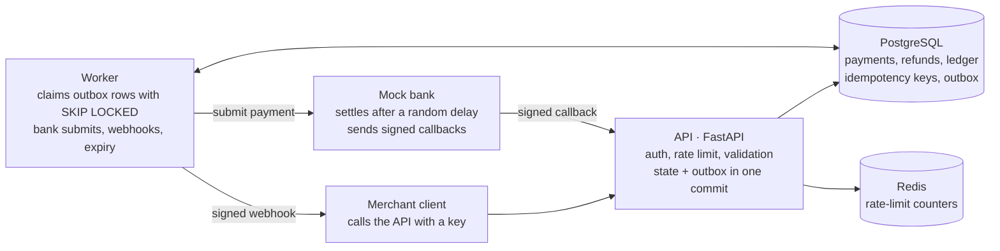
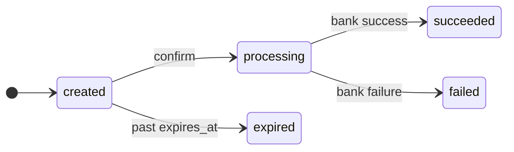
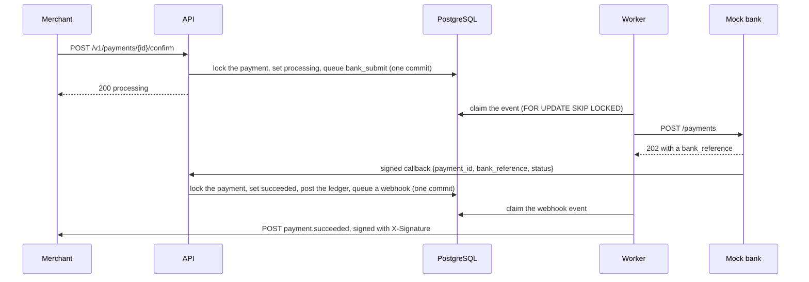

# Mini Payment Gateway

[](https://github.com/Starscourge/mini-payment-gateway/actions/workflows/ci.yml)

A payment gateway backend that keeps money records correct under retries, failures and
concurrency. Merchants create payment orders in INR, a mock bank settles them over a real
network, and the gateway posts every movement to a double-entry ledger and tells the merchant
through signed webhooks. No real money moves.

Built with Python 3.12, FastAPI, PostgreSQL 16, Redis 7, SQLAlchemy 2 (async) and Docker.

- **Retries are safe.** Creating, confirming and refunding require an `Idempotency-Key`. A retry
  gets the stored response back instead of a second charge, and reusing a key for a different
  request is rejected.
- **Nothing is lost between the database and the network.** A state change and the side effect
  it causes (a bank submission, a webhook) commit together through a transactional outbox, and
  a worker delivers them.
- **Money adds up.** Amounts are integer paise. Every movement is a balanced double-entry
  ledger transaction, and balances are summed from the ledger.
- **Races are decided by row locks.** Twenty parallel refunds never exceed the payment, and
  duplicate bank callbacks settle a payment once.
- **Webhooks are at least once.** They are HMAC-signed, retried with exponential backoff, logged
  per attempt, dead-lettered after ten failures, and can be redelivered on request.
- **Security basics are in place.** API keys are stored as SHA-256 hashes. Merchants are
  isolated (another merchant's payment is a 404). Webhook URLs are checked against SSRF, with
  DNS pinning. Each key is rate-limited in Redis.
- **It is tested.** 346 tests run against real Postgres and Redis, with 96% branch coverage and
  strict mypy, in CI on every push.

## Quickstart

You need Docker and nothing else.

```bash
git clone https://github.com/Starscourge/mini-payment-gateway.git
cd mini-payment-gateway
docker compose up --build
```

This starts five services: the API, the worker, the mock bank, Postgres and Redis. The API
applies the database migrations as it starts. When it reports healthy, Swagger is at
**<http://localhost:8000/docs>**.

### A guided tour

In a second terminal:

```bash
docker compose exec api python -m scripts.demo
```

The [demo script](scripts/demo.py) plays a merchant against the running stack and says what each
step shows. It also runs a webhook endpoint and checks every signature it receives.

<details>
<summary>Example output</summary>

```text
1. Sign up a merchant
   merchant mer_be7aaf9c9c4d4056ac2c7bc8e1b079ba, webhooks to http://api:9000/webhooks
   API key sk_test_iRLe... is shown once; the gateway keeps its hash

2. Create a ₹499.00 payment, then retry it as a client would
   POST /v1/payments -> pay_f73a4340dd2b48dcac09639b816e9f3c (created)
   same Idempotency-Key and body -> pay_f73a4340dd2b48dcac09639b816e9f3c again
   (Idempotent-Replayed: true): the stored response, not a second payment
   same key with a different body -> 422 idempotency_key_reused

3. Confirm it; the worker submits it to the mock bank, whose signed callback settles it
   POST /confirm -> processing
   failed after 1.8 s
   the mock bank declines about 10% of payments (declined_by_issuer)
   failed is final, so take a new payment
   POST /confirm -> processing
   succeeded after 3.1 s
   the status change, the ledger postings and the webhook event committed together

4. Receive the payment.succeeded webhook, after one failed delivery
   evt_6c7f5aae6ff44e3a87d1018e2096d9d9 arrived, signature valid
   our endpoint answered 503, as a briefly unavailable server might
   the delivery log: pending, 'merchant returned HTTP 503'
   next attempt in 29 s (backoff: 30 s doubling, ±20% jitter)
   instead of waiting: POST /v1/webhook-events/{id}/redeliver
   evt_6c7f5aae6ff44e3a87d1018e2096d9d9 arrived again, signature valid, -> 200
   same event ID: delivery is at least once, so merchants drop duplicates by ID
   attempts: HTTP 503, HTTP 200

5. Refund ₹100.00, then try to refund more than is left
   POST /refunds -> rfd_07947c50ed684c59af7d69fc5da41f49 (succeeded)
   refund ₹499.00 more -> 409, in the one error shape:
   {"error": {"code": "refund_exceeds_amount", "message": "Refund of 49900 exceeds the 39900 still refundable.", "request_id": "req_32061e5728bc492a836fa240325ffcb4"}}
   webhook refund.succeeded evt_bd081b3c57944aa0a6d167f86ebd959b, signature valid

6. Check the balance
   ₹399.00, summed from the double-entry ledger:
   +₹499.00 for the payment, -₹100.00 for the refund

7. Look up the payment as another merchant
   -> 404 payment_not_found: not 403, which would confirm it exists
```

</details>

### Trying it in Swagger

1. `POST /v1/merchants` with `{"name": "My Store"}`. Copy `api_key.key` from the response: it
   is shown only once.
2. Click **Authorize** and paste the key.
3. `POST /v1/payments` with `{"amount_paise": 49900}` and any unique `Idempotency-Key`.
4. `POST /v1/payments/{id}/confirm` with another new key, then `GET /v1/payments/{id}` until it
   is `succeeded` or `failed`, usually within three seconds.
5. Try a refund, `GET /v1/balance`, or the delivery log at `GET /v1/webhook-events`.

### If a port is taken

Compose publishes the API on 8000, the bank on 8001, Postgres on 5432 and Redis on 6379, all
on `127.0.0.1` only. If you already run Postgres or Redis locally, choose another host port for
this run:

```bash
POSTGRES_HOST_PORT=55432 REDIS_HOST_PORT=56379 docker compose up --build
```

`API_HOST_PORT` and `BANK_HOST_PORT` work the same way. Stop the stack with
`docker compose down`, and add `-v` to delete the database too.

## How it works

The API never calls the bank or a merchant itself. It records what has to happen in an `outbox`
table in the same transaction as the state change, and a separate worker makes the HTTP calls.
Postgres is the only source of truth. Redis holds nothing but rate-limit counters, which can be
lost without harm.



A payment's status only moves forward, and it ends in exactly one final state. Refunds don't
change it.



Settling a payment:



The mock bank is a separate service, so the hard cases happen over a real network. It declines
about 10% of payments, sends 10% of callbacks twice, and accepts 5% of submissions but answers
them with a 503, so the worker has to retry without paying twice.

## Design decisions

Each choice is recorded with its reasoning in [docs/decisions.md](docs/decisions.md). The main
ones:

| Decision | Why |
| --- | --- |
| A Postgres outbox, not a job queue such as Celery | The side effect commits in the same transaction as the state change, so a crash can neither lose a bank submission nor send one for a change that rolled back. One less system to run. |
| `FOR UPDATE SKIP LOCKED` to claim events | Several workers share the outbox without taking the same row. The load test shows it: three workers cut settlement time under load from 9.3 s to 3.5 s with no code change. |
| Integer paise and a double-entry ledger | Floats can't represent most decimal amounts exactly. Balanced entries make an error show up as a non-zero sum instead of a silently wrong balance. |
| Idempotency keys claimed in the request's transaction | `INSERT ... ON CONFLICT DO NOTHING` makes a concurrent duplicate wait on the original. A failed request stores nothing, so its key stays free for a retry. |
| Row locks on the payment for confirm, refund and callback | They serialise the races that matter, and a CHECK constraint backs up the refund limit. |
| Callbacks find the payment by `payment_id` | A fast bank's callback can arrive before the worker has stored the reference from the bank's reply, or the reply can be lost. A lookup by reference would strand the payment in `processing` (decision 11). |
| At-least-once webhooks with a stable event ID | A timeout after the merchant received the event means a retry, so the event ID is what merchants deduplicate on. |
| SSRF checks before every delivery, pinned to the checked IP | DNS can change after signup. Pinning the connection to the address that passed the check closes DNS rebinding. |
| A rate limiter that fails open | Redis holds only counters. If it is down, requests go through and a warning is logged. |
| 404, not 403, for another merchant's resources | A 403 would confirm that the ID exists. |
| No live deployment | The whole stack runs in one command, and a free host would sleep or reclaim an always-on worker (decision 38). |

## Correctness, and how it is tested

| Guarantee | Enforced by | Tested by |
| --- | --- | --- |
| A retried request has its effect once | Idempotency keys | 10 parallel creates with one key make one payment |
| Refunds never exceed the payment | Row lock and a CHECK constraint | 20 parallel refunds |
| A payment settles once | Row lock, final states ignore callbacks, a unique ledger index | 10 parallel duplicate callbacks |
| A confirm reaches the bank once | Row lock and the state machine | 10 parallel confirms |
| Every ledger transaction balances | `ledger.post` refuses an unbalanced transaction before writing it | Checked after every integration test |
| Merchants can't see each other's data | Every query filters by the authenticated merchant | Payment, refund, list, balance, API key and idempotency requests made as another merchant |

Tests run against real Postgres and Redis (never SQLite, whose locking differs). Most run
inside a transaction that is rolled back afterwards. The concurrency tests commit for real and
fire requests at once with `asyncio.gather`, and they passed 50 runs in a row before they were
trusted. After the load test below, every one of 8,957 succeeded payments had exactly one ledger
posting, and merchant balances matched payments minus refunds to the paisa.

## Load test

The [Locust scenario](loadtest/locustfile.py) is what a merchant's checkout does: create a
payment, confirm it, and poll every 0.5 s until it is settled. Each simulated user is its own
merchant. Each run lasted 60 seconds with no failed requests.

| API processes | Workers | Users | HTTP req/s | HTTP p50 | HTTP p95 | Payments settled/s | Settlement p50 / p95 |
| ---: | ---: | ---: | ---: | ---: | ---: | ---: | ---: |
| 1 | 1 | 50 | 99 | 160 ms | 370 ms | 13.7 | 3.3 s / 4.7 s |
| 4 | 1 | 100 | 250 | 18 ms | 110 ms | 25.9 | 3.7 s / 5.2 s |
| 4 | 1 | 200 | 374 | 100 ms | 250 ms | 20.3 | 9.3 s / 11.2 s |
| 4 | 3 | 200 | 343 | 200 ms | 590 ms | 49.1 | 3.5 s / 4.9 s |

Settlement is measured from the confirm request until a poll sees the final status. Most of it is
the mock bank's simulated 0.5–3 s delay, and it is precise only to the 0.5 s poll interval.

What the runs show:

- **One API process is CPU-bound at about 100 requests per second.** The API is stateless, so
  four processes served twice the users with 2.5 times the throughput and a lower p95.
- **At 200 users, the single worker became the bottleneck.** It handles one event at a time, and
  the settlement median rose to 9.3 s. Three workers brought it back to 3.5 s, and 2.4 times as
  many payments settled per second. HTTP requests per second fell slightly in that run because
  faster settlement means fewer polls per payment.

Machine: a laptop with an Intel Core Ultra 7 155H (16 cores, 22 threads), running Docker 29.8.2
under WSL2 with 7.5 GB of memory. Locust ran on the same machine, so it competed with the stack
for CPU. To reproduce the last row:

```bash
RATE_LIMIT_PER_MINUTE=1000000 WEB_CONCURRENCY=4 docker compose up --build -d --scale worker=3
uv run locust -f loadtest/locustfile.py --host http://localhost:8000 \
    --headless --users 200 --spawn-rate 50 --run-time 60s
```

The rate limit is raised because each user polls faster than the default 100 requests a minute,
and the test measures the gateway, not the limiter.

## API

| Method and path | What it does |
| --- | --- |
| `POST /v1/merchants` | Sign up. Returns the API key and the webhook secret, once. Needs `X-Admin-Token` when `ADMIN_TOKEN` is set, as production requires. |
| `POST /v1/api-keys`, `DELETE /v1/api-keys/{id}` | Issue or revoke keys, e.g. to rotate them |
| `POST /v1/payments` | Create a payment (needs an `Idempotency-Key`) |
| `GET /v1/payments`, `GET /v1/payments/{id}` | List (cursor pagination) or fetch payments |
| `POST /v1/payments/{id}/confirm` | Send it to the bank (needs an `Idempotency-Key`) |
| `POST /v1/payments/{id}/refunds`, `GET` the same path | Refund part or all of a payment (needs an `Idempotency-Key`), or list its refunds |
| `GET /v1/balance` | What the gateway owes the merchant, from the ledger |
| `GET /v1/webhook-events` | Webhook events with every delivery attempt |
| `POST /v1/webhook-events/{id}/redeliver` | Queue a failed or dead event again |
| `POST /internal/bank/callback` | The bank's signed callback (HMAC, not an API key) |
| `GET /health`, `GET /ready` | Liveness, and readiness including Postgres and Redis |

Every error has one shape, `{"error": {"code", "message", "request_id"}}`, and every response
carries an `X-Request-ID`. Webhooks and bank callbacks carry
`X-Signature: t=<unix time>,v1=<HMAC-SHA256 of "{t}.{body}">`, and receivers reject signatures
more than five minutes old.

## Development

Development uses [uv](https://docs.astral.sh/uv/).

```bash
uv sync                                         # install from the lockfile
docker compose up -d postgres redis             # the tests need both
uv run pytest                                   # creates and migrates its own gateway_test database
uv run pytest --cov                             # with branch coverage
uv run ruff check . && uv run ruff format .
uv run mypy .                                   # strict
uv run pre-commit run --all-files               # every hook: hygiene, lockfile, ruff, mypy
uv run uvicorn app.main:create_app --factory --reload   # the API alone, on :8000
uv run python -m app.worker.main                # the worker alone
```

To vet the concurrency tests:

```bash
for i in $(seq 50); do uv run pytest tests/integration/test_concurrency.py -q -x || break; done
```

CI runs ruff, strict mypy, the migrations (including a check that they match the models), the
test suite with Postgres and Redis service containers, and a Docker build.

## Project structure

```text
app/
  api/          routers (kept thin), auth, idempotency and rate-limit dependencies
  services/     business logic: payments, refunds, ledger, idempotency, outbox, webhooks
  security/     HMAC signing, SSRF checks, API keys
  worker/       the outbox polling loop and its handlers
  models/       SQLAlchemy models
  schemas/      Pydantic request and response models
mock_bank/      the simulated bank, a separate FastAPI app
migrations/     Alembic
tests/          unit/ and integration/
scripts/        demo.py, the guided tour
loadtest/       locustfile.py
docs/           decisions.md, the design decision log
```

Services never import FastAPI, so the worker reuses them and tests call them directly.

## Scope and limitations

- **Simulated.** The bank is a mock, amounts are INR only, and keys are test-mode
  (`sk_test_...`). No real money moves.
- **Refunds are immediate.** They don't go through the bank and have no pending state.
- **Webhook secrets are stored in plaintext**, because the gateway needs them to sign.
  Encrypting them at rest is a possible next step.
- **It is not deployed** (decision 38). Production settings exist and are enforced:
  `ENVIRONMENT=production` refuses to start without `ADMIN_TOKEN` and `BANK_CALLBACK_SECRET`,
  and requires https webhook URLs.
